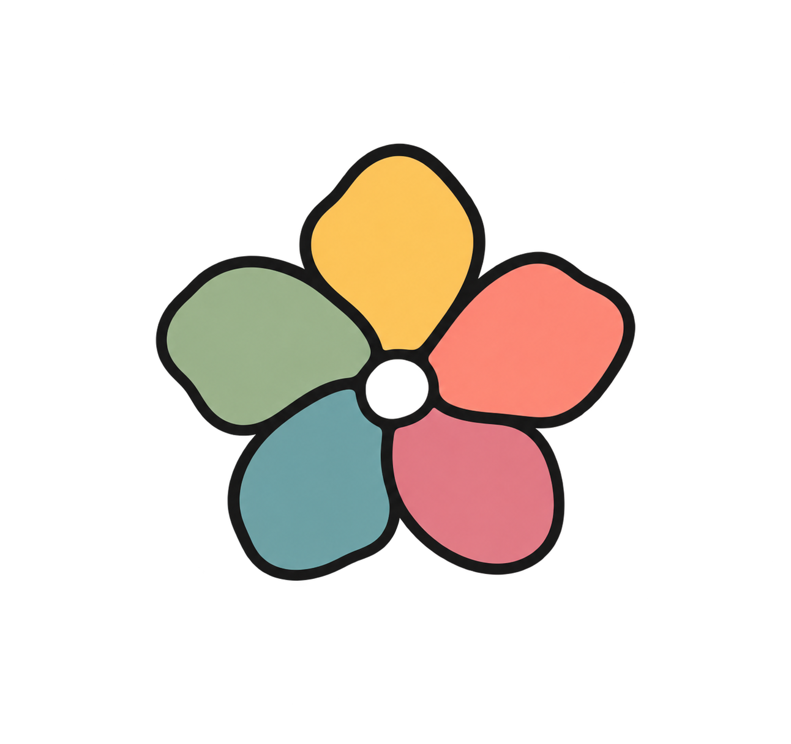
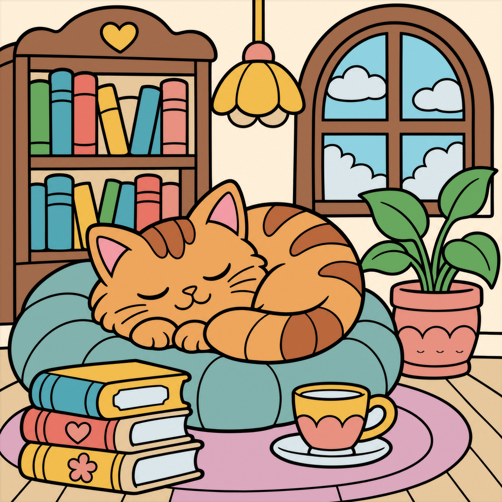

<div align="center">
  

  # Colora

  **Un pequeño espacio para colorear, crear y disfrutar el proceso.**

  [Jugar a Colora](https://colora.ccastillo.dev/) · [Instalación](#ejecutar-en-local) · [Cómo funciona](#cómo-funciona) · [Contribuir](#contribuir)
</div>

Colora es un juego de colorear por números para el navegador. Elige una ilustración, píntala a tu ritmo y, al terminar, revive tu proceso antes de guardar tu obra enmarcada y firmada.

<div align="center">
  
  <br>
  <sub>Una de las ilustraciones disponibles, mostrada con sus colores completos.</sub>
</div>

## Características

- **Cinco ilustraciones:** girasol, rosa roja, capibara con nieve, gato en una librería y tulipán rosa. Cada una tiene su propia paleta y dificultad.
- **Colorea a tu manera:** puedes usar cualquier color en cualquier pieza. Completa todas las piezas de un número con el color correspondiente para bloquearlo en la paleta.
- **Herramientas para corregir:** deshaz el último cambio o borra una pieza.
- **Tu obra, tu firma:** escribe tu nombre al comenzar y cámbialo cuando quieras. El nombre se comparte entre las ilustraciones durante la sesión.
- **Celebra el resultado:** al terminar, se reproduce el proceso de coloreado y la obra aparece enmarcada, firmada y sin números.
- **Descarga en PNG:** guarda la ilustración terminada con su marco y firma.
- **Respeto por movimiento reducido:** las animaciones principales se adaptan a la preferencia del sistema.

> El nombre y el progreso se conservan mientras la página permanezca abierta, incluso al cambiar de ilustración. Por ahora se pierden al recargar o cerrar la página. La aplicación no requiere crear una cuenta.

## Cómo funciona

1. Escribe el nombre con el que quieres firmar.
2. Elige una ilustración en la barra lateral y selecciona un color.
3. Colorea sus piezas; usa el borrador o deshaz si quieres cambiar algo.
4. Completa todos los colores. Después de la reproducción verás tu obra firmada y podrás descargarla.

## Ejecutar en local

Necesitas **Node.js 22.12 o superior** y npm.

```bash
git clone https://github.com/JCastilloPadilla/Mandalas.git
cd Mandalas
npm ci
npm run dev
```

Abre la dirección local que muestra Vite en la terminal, normalmente `http://localhost:5173/`. No se necesitan variables de entorno, base de datos ni servidor de aplicaciones para la versión actual.

## Comandos

| Comando | Acción |
| --- | --- |
| `npm run dev` | Inicia el servidor local con recarga durante el desarrollo. |
| `npm test` | Ejecuta las pruebas con Vitest. |
| `npm run build` | Comprueba TypeScript y genera el sitio de producción en `dist/`. |

La salida de `dist/` contiene archivos estáticos y puede servirse desde un servidor web. Para probar las imágenes, abre la aplicación a través de un servidor HTTP en lugar de abrir `index.html` directamente.

## Tecnologías y estructura

El proyecto utiliza **React**, **TypeScript**, **Vite** y **Canvas**. Las ilustraciones combinan una imagen de líneas con una máscara de regiones: cada identificador se relaciona con un número y una posición de etiqueta. El estado de pintura y el historial viven en la memoria de la aplicación; la descarga se compone en el navegador.

```text
public/                 Ilustraciones, máscaras y recursos visuales
src/main.tsx            Interfaz, paletas y estado de cada ilustración
src/SunflowerCanvas.tsx Renderizado y selección de piezas en Canvas
src/*-regions.json      Números y posiciones de las piezas
game.ts                 Reglas de coloreado, progreso y deshacer
src/downloadArtwork.ts  Composición de la descarga en PNG
game.test.ts            Pruebas de reglas y datos
```

## Contribuir

Las sugerencias y reportes de problemas son bienvenidos. Si quieres proponer un cambio, consulta [CONTRIBUTING.md](CONTRIBUTING.md). Antes de enviar un pull request, ejecuta `npm test` y `npm run build`.

## Créditos

Creado por **Jose Carlos Castillo y ChatGPT con mucho amor** ❤️. Las ilustraciones se generaron con ayuda de IA y se adaptaron para el juego. La firma utiliza trazos de Hershey y, como alternativa para caracteres no disponibles, la tipografía [Allura](https://github.com/googlefonts/allura), distribuida bajo SIL Open Font License 1.1.

El repositorio aún no especifica una licencia para el proyecto y sus ilustraciones.
